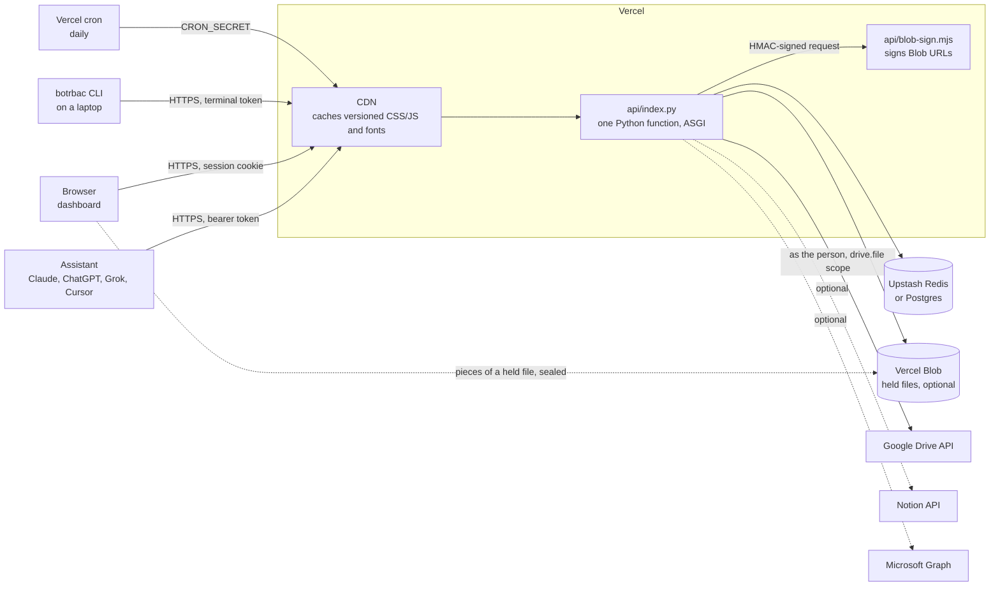

# Architecture

How Bot RBAC is put together, why, and where its limits are. Security rules are in
[security.md](security.md); the file-by-file layout is in [development.md](development.md).

## The problem

An assistant connected to Google Drive can usually reach the whole Drive. Bot RBAC is a proxy that
speaks MCP on one side and the Drive API on the other, and refuses every call that is not for a file
the person allowed. Two things follow from that:

- **It must fail closed.** If it cannot tell whether a file is allowed, the answer is no.
- **It must stay small enough to audit.** One function, one store, no background workers.

## System



Everything is one ASGI app (`server.build_app`). `vercel.json` rewrites every path except the Blob
signer to it. The app is stateless: any instance can serve any request, and all state is in the store.

### Why one function

| Choice | Reason | Cost |
|---|---|---|
| One Python function for MCP, OAuth and the dashboard | One deploy, one set of secrets, one place the allowlist is checked. Fits Vercel's free plan | Cold starts import everything; no independent scaling of the dashboard |
| A second, tiny Node function | Vercel's Blob client-token signing exists only in the Node SDK. It holds no logic: it checks an HMAC from the Python app and signs a URL | Two runtimes to keep patched (dependabot covers both) |
| Stateless MCP (JSON responses, a session manager per request) | Serverless runtimes may skip ASGI lifespan, and nothing needs a stream. Any instance can answer | No server-initiated messages; assistants poll (`check_messages`) or are woken by a webhook |
| A key-value store, not a relational schema | The data is small, per person, and read by key. Redis and Postgres both implement the same small interface (strings, hashes, lists, counters), so a self-hoster picks either | No joins or ad-hoc queries; listing "all users" is an index hash, not a scan |
| No queue or worker | Every job is short. Clean-up runs inside requests and from one daily cron | A job that outlives a request cannot exist; uploads are capped to fit |

## A tool call, step by step

`POST /mcp` with `{"method":"tools/call","params":{"name":"read_file",...}}`:

1. **`SecurityHeadersMiddleware`** adds CSP, nosniff, no-store and HSTS to whatever comes back.
2. **`AuthFailureLimitApp`** turns an address away once it has sent too many refused bearers.
3. **`BearerAuthMiddleware`** resolves the token: a static `API_TOKENS` entry (constant-time hash
   compare) or an OAuth access token (looked up by SHA-256; the store never holds the token). It sets
   three context variables: the principal (role, app), the actor (whose Drive), and the guest (set
   when a paired person's assistant is reading someone else's shared items).
4. **`RateLimitApp`** counts the call per connection in a fixed window (300 a minute by default).
5. **`StatelessMCPEndpoint`** runs FastMCP for this one request.
6. **`policy.require("read_file")`** checks the role, writes the audit row whatever happens, and maps
   errors. Registration refuses any tool that is not wrapped this way for its own name
   (`ScopedFastMCP.add_tool`), so there is no tool this step does not cover.
7. **`DriveService`** asks **`ScopeGuard`** whether the file is in scope. The guard fetches the file's
   metadata fresh, walks its parents breadth-first (capped in depth and lookups, cycle-safe) and
   allows it only if it or an ancestor is on the allowlist. Out of scope becomes an
   `access_required` error with an approval link.
8. Only then is the content fetched from Drive, as the person, and capped (`MAX_BYTES`, `MAX_CHARS`).
   PDF and Office files are parsed in a child process with memory, CPU and time limits.

Blocking work (the Google client, the store) runs in worker threads; context variables are copied in.

## Where the code is

```
api/index.py ──▶ server.py            build_app(): the one place everything is wired together
                   ├─ auth.py, ratelimit.py, mcp_oauth.py      who is calling
                   ├─ tools/        one module per group of MCP tools; each tool wrapped by policy.require
                   │    └─ service.py ─▶ scope.py ─▶ drive_client.py     allowlist check, then Google
                   ├─ dashboard.py   session, CSRF and error wrappers, headers, assets, route table
                   │    └─ pages/    one module per group of pages
                   ├─ bridge/, external.py, drops.py            pairing, mail, sharing with people
                   ├─ ops.py         readiness and scheduled clean-up
                   └─ store/         backends ─ wrappers (prefix, signing, per-person) ─ records
```

Dependencies point down and to the right: tools and pages call services, services call the store
and the Drive client, and nothing below `server.py` imports it.

## Data model

All keys sit under `sdm:`. One person's records sit under `sdm:u:<email>:`; the admin's sit at the
root for historical reasons. `ActorStore` adds the prefix from the actor context variable, so code
that handles one person's data cannot name another's.

| Records | Key (below the prefix) | Notes |
|---|---|---|
| Allowlist, Sharing list, Notion, OneDrive and X lists | `allowlist`, `ext_allowlist`, … (hashes) | **Signed.** Field is the file id |
| Stored sign-ins | `vault:*` | Fernet-encrypted with `ENCRYPTION_KEY`; the record names its account |
| Connected apps | `oauth:grants`, `oauth:at:<hash>`, `oauth:rt:<hash>`, `oauth:code:<hash>` | **Signed.** Tokens stored as SHA-256 only, each with a TTL |
| Access requests | `req:<id>`, pending index | TTL; deduplicated per file |
| Pairings and mail | `bridge:link:*`, `bridge:msg:*`, inbox lists | **Signed** links; mail expires after 14 days |
| Activity | `activity` (list, newest first, 500 kept) | Names and ids, never contents |
| Terminal | `term:*` | **Signed.** Roles, terminals, tokens, revoked sessions |
| Rate limits, idempotency marks, upload pieces | `rl:*`, `once:*`, `upload:*` | TTL only |

**Signed** means the value carries an HMAC over its key, field and value, keyed from
`ENCRYPTION_KEY`. Someone who can write to the store but does not hold that key cannot add an
allowlist entry, mint a token record, or move a record to another person. A record that fails the
check reads as missing, and missing never means allowed.

The store interface (`store.KeyValueStore`, in `store/backends.py`) has three backends:
`MemoryStore` (tests, local), `RedisStore` (Upstash REST) and `PostgresStore`. `tests/test_store_backends.py` runs one contract
against all three, with real servers in CI.

## Consistency and caching

There are two caches, both per instance, both small on purpose:

| Cache | TTL | What a stale entry can do |
|---|---|---|
| The allowlist | 2 s | A revoked file stays readable for up to 2 s on another instance |
| Drive ancestry (which folder a file is in) | 60 s | A file **moved out** of an allowed folder stays readable for up to 60 s |

The file's own metadata is never cached, and there is no cache for tokens, roles or pairings:
disconnecting an app or turning a pairing off takes effect on the next call.

Counters (`incr`), claims (`set_if_absent`), single-use codes (`getdel`) and compare-and-swap are
atomic on every backend (Lua on Redis, single statements or a transaction on Postgres). Where two store writes must
both happen, the code orders them so that a crash in between leaves less access, not more: a revoke
removes the allowlist entry before it touches Drive, and a marker closes the race between a revoke
and a token being issued.

## When something fails

| Failure | Result |
|---|---|
| Store unreachable | Tool calls and pages fail (the allowlist cannot be read). `/health/ready` answers 503; `/health` stays 200. The rate limiter alone fails open: it guards load, not access |
| Google unreachable or the token revoked | The tool returns an error; the dashboard says Drive failed (502). Nothing is served from cache |
| Record tampered with in the store | Reads as missing; the call is refused |
| A document that tries to exhaust the parser | The child process hits its memory, CPU or time limit and is killed; the tool returns no text |
| Misconfiguration at start | A 503 app that logs the setting names. On Vercel with no store configured it refuses to serve instead of using per-instance memory |
| Clean-up job fails | Reported, the other jobs still run, the cron run is marked failed. Nothing depends on clean-up for correctness |

## Limits

Sized for a personal or small-team deployment on free tiers. Where it stops scaling, in order:

1. **Drive lookups per call.** A cold scope check costs one metadata read plus up to one per
   ancestor. Listing the top level with many allowed items reads each one. Google's per-user quota
   is the first ceiling a heavy user meets.
2. **Store round-trips per call.** About ten for a tool call (token, grant, rate limit, allowlist,
   activity). Upstash REST is one HTTPS request each; Postgres reuses a connection for them.
3. **Activity is one list per person**, capped at 500. It is a recent-history view, not an audit
   archive. For retention, drain the JSON audit lines from the function's logs.
4. **Fixed-window rate limits** allow up to twice the limit across a window boundary.
5. **Mailbox index lists** (`bridge:linkmsgs:*`) are trimmed only when a pairing is purged; a very
   long-lived, very chatty pairing grows them. The messages themselves expire.

## Known debt

Written down so it is a decision, not a surprise.

- **`Mailbox` is one class in three files.** `bridge/` splits it into pairing, mail and webhooks
  as mixins, with what each needs from the others declared. That made it reviewable without
  changing how anything calls it, but mixins are a step, not the end: the webhook part needs only
  the store and the wake settings (bar one report), and should become its own object that
  `Mailbox` holds.
- **The largest modules left** are `mcp_oauth.py` (1,550 lines, the OAuth server), `extract.py`
  (1,400, one parser per file format) and `dashboard.py` (1,200: the session, CSRF and error
  wrappers, security headers, static assets and the route table). Each does one job; `extract.py`
  would split by format if it grows.
- **Atomic operations are not all in the store interface.** `swap`, `getdel` and `replace_list` exist
  on every backend but are reached with `getattr`, and `replace` exists only on `SignedStore`.
  Without `ENCRYPTION_KEY` (static-token deployments only) two pairing updates fall back to
  last-writer-wins.
- **Refresh rotation is not transactional.** If the store fails between retiring the old refresh
  token and saving the new one, the app's next refresh is treated as reuse and the app is
  disconnected. It fails closed; the person reconnects the app.
- **"Read only" apps can use the mailbox** (`send_message`, `reply`, `set_webhook`). Those change
  state. Moving them to the edit role is a product decision.
- **Terminal's enforcement is on the person's own computer.** A person who edits the cached policy
  and its signature key can widen their own role ([security.md](security.md) says so). It limits
  agents, not the human who owns the machine.

## Scorecard

Scored against what a design review would ask of a system this size. 10 is "nothing a reviewer
would change".

| Area | Score | Why |
|---|---|---|
| Access control correctness | 9.5 | Role and allowlist checks cannot be skipped: registration enforces the first, every service method goes through the guard, and both fail closed. Signed records, hashed tokens, per-tenant key prefixes |
| OAuth and sessions | 9 | Exact redirect match, S256 only, atomic single-use codes, rotation with reuse detection, CSRF on every form. Non-transactional rotation (above) costs the point |
| Untrusted input | 9 | Documents parsed in a limited child process; Drive queries built from a fixed template; webhook targets allowlisted and pinned to a public address |
| Data layer | 8.5 | One contract over three backends, tested against real servers; atomic primitives; expiry and sweep on all of them. The interface gap above keeps it from higher |
| Reliability and operations | 8.5 | Liveness and readiness, scheduled clean-up, fail-closed startup, errors labelled by cause. No tracing or metrics beyond logs and Vercel's own |
| Performance and cost | 8.5 | Static assets served from the CDN, pooled store connections, bounded Drive fan-out, blocking work off the event loop. Top-level listing is still one read per allowed item |
| Testing | 9 | 1,700 tests with no network, a fake Drive that enforces the same query grammar, backend contract tests, a Node suite for the signer |
| Delivery | 8.5 | Locked dependencies, pinned actions, drift check for the deploy manifest, dependabot. No type checker in CI |
| Documentation | 9 | Threat model, self-hosting, every tool and every setting, and this document |
| Code organisation | 8.5 | One composition root (`server.build_app`); tools, pages, store and pairing each split by concern, with no module over 1,550 lines and most under 900. `Mailbox` as mixins and the three large single-purpose modules (above) keep it from higher |
